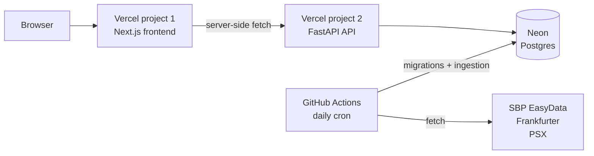

# Deploying BachatCheck

Everything runs on free tiers with no credit card (as of November 2026: free tiers change
often, so check each provider's pricing page).



| Piece | Host | Why |
|---|---|---|
| Database | **Neon** (free) | Serverless Postgres: 1 GB per project and 100 compute-hours a month, plenty for this app. It doesn't expire. |
| API | **Vercel** (Hobby), FastAPI on the Python runtime | No card. Vercel runs FastAPI natively as a function, so cold starts take seconds. Render's Blueprint flow asked for a card, and its free tier sleeps for ~1 min. Vercel's Python runtime is still labelled beta; the self-contained Docker image in [`infra/api.Dockerfile`](infra/api.Dockerfile) runs on any Docker host if you'd rather. |
| Frontend | **Vercel** (Hobby) | First-class Next.js hosting. Hobby is for personal, non-commercial projects, which fits a portfolio piece. |
| Migrations + daily ingestion | **GitHub Actions** | Free for public repos. Serverless functions have no startup hook, so the workflow runs `alembic upgrade head` before every ingestion run. |

Both Vercel projects are pinned to Singapore (`sin1`), next to the Neon database.

## 1. Database: Neon

1. Create a project at <https://neon.com> (region: **AWS Asia Pacific (Singapore)**).
2. Get its connection strings. Either copy them from the console's **Connect** dialog, or link
   the repo with the Neon CLI, which writes them into your git-ignored `.env`:

   ```bash
   npm i -g neon
   neon login
   neon init -y --agent claude-code --org-id <org-id> --project-id <project-id> --no-config
   ```

   You get `DATABASE_URL` (**pooled**, host contains `-pooler`: use this for the API) and
   `DATABASE_URL_UNPOOLED` (direct: use this for migrations). Paste them as is; the app rewrites
   `postgresql://` to use the psycopg 3 driver.

   > With the CLI, `.env`'s `DATABASE_URL` now points at Neon. Local Docker isn't affected,
   > because `docker-compose.yml` sets `DATABASE_URL` for its containers and that wins over
   > `.env`.
3. Create the schema once (the GitHub workflow keeps it up to date afterwards):

   ```bash
   docker compose run --rm --no-deps -e DATABASE_URL="<DATABASE_URL_UNPOOLED>" --entrypoint sh ingestion -c "cd /repo/backend && alembic upgrade head"
   ```

## 2. API: Vercel project `bachatcheck-api`

1. On <https://vercel.com>: **Add New → Project**, import `BachatCheck`.
2. **Root Directory: `backend`**. Vercel detects FastAPI from [`backend/index.py`](backend/index.py)
   and installs the dependencies from `backend/pyproject.toml` (Python version from
   `backend/.python-version`).
3. **Environment variables** (Production):

   | Name | Value |
   |---|---|
   | `DATABASE_URL` | Neon **pooled** string |
   | `CORS_ORIGINS` | the frontend URL from step 3, e.g. `https://bachatcheck.vercel.app` (put `http://localhost:3000` until you have it) |
   | `FUNDS_DATA_MODE` | `demo` (MUFAP's terms don't allow public display of its data) |
   | `STOCKS_DATA_MODE` | `real` |
   | `TRUST_FORWARDED_FOR` | `true` (Vercel's edge sets `X-Forwarded-For`) |
   | `LOG_JSON` | `true` |
   | `ENVIRONMENT` | `production` |

4. Deploy, then open `https://<api-project>.vercel.app/api/v1/health`. You should see
   `{"status":"ok", ..., "database":"ok"}`. API docs are at `/docs`.

## 3. Frontend: Vercel project `bachatcheck`

1. **Add New → Project**, import `BachatCheck` again.
2. **Root Directory: `frontend`** (Next.js is detected).
3. Environment variable: `NEXT_PUBLIC_API_URL` = `https://<api-project>.vercel.app` (no
   trailing slash).
4. Deploy. Copy the production URL into the API project's `CORS_ORIGINS`, then redeploy the API
   (Deployments → ⋯ → Redeploy).

## 4. Daily data: GitHub Actions

1. In the GitHub repo: **Settings → Secrets and variables → Actions → New repository secret**:
   - `DATABASE_URL`: the Neon **unpooled** string (the workflow runs migrations too).
   - `SBP_EASYDATA_API_KEY`: your EasyData key. **It expires every 90 days**: regenerate it at
     easydata.sbp.org.pk (My Data Basket → My Account) and update this secret.
2. Load history once: **Actions → Ingest data → Run workflow**, then:
   - source `daily`, backfill from `2015-01-01` (policy-rate history needs pre-2016 data), then
   - source `psx`, backfill from `2016-07-01`.
3. From then on, [`ingest.yml`](.github/workflows/ingest.yml) runs by itself:
   - **22:30 PKT daily**: tax rules, gold CSV, Frankfurter (USD/PKR), SBP.
   - **16:00 PKT weekdays**: PSX, after the 15:30 close.

   Each run writes `job_runs` rows (see `/api/v1/freshness` and the Methodology page). A
   failed source never deletes data, so the site keeps showing the last good values.

> GitHub pauses scheduled workflows in a public repo after **60 days without commits**. If the
> data stops updating, re-enable the workflow under Actions or push any commit.

MUFAP isn't in the workflow on purpose: its export is downloaded by hand for personal use and
stays local (see `data/README.md`).

## 5. Check it works

- [ ] `GET <api>/api/v1/health` returns `"database":"ok"`
- [ ] `GET <api>/api/v1/freshness` lists recent successful runs for `sbp`, `frankfurter`, `psx`
- [ ] The frontend's Compare page shows the inflation headline and the chart
- [ ] The Funds page shows the **Demo data** badge
- [ ] The Methodology page lists every source with a "Last updated" date
- [ ] A browser request to the API from any other origin is blocked by CORS

## Updating

- **Code:** push to `main`. CI runs and both Vercel projects redeploy automatically.
- **Schema changes:** a new Alembic migration is applied by the next workflow run. Run the
  workflow manually right after deploying one.
- **Tax rates:** edit `data/tax_rules.yaml` (set `rate`, `source_url`, `verified: true`), push,
  then run the workflow with source `tax_rules`.
- **Gold:** add rows to `data/gold/gold_pkr_per_tola_24k.csv`, push, run source `gold`.

## Limits to watch

| Limit | What happens | What to do |
|---|---|---|
| Vercel Hobby: personal, non-commercial use only | Fine for a portfolio project | Move to Pro if it becomes commercial |
| Vercel functions: per-instance memory | The in-process response cache and rate limiter are per instance, so limits are approximate | Fine at this scale. Use a shared store (e.g. Redis) if traffic grows |
| Neon free: 1 GB storage | Writes fail when full | `raw_snapshots` grows daily. Prune old rows if needed (`DELETE FROM raw_snapshots WHERE fetched_at < now() - interval '90 days'`) |
| Neon free: compute scales to zero when idle | The first query after a pause takes a moment | Expected; the frontend waits up to 50 s and explains a slow wake-up |
| SBP API: key expires every 90 days, 2,000 calls/day | SBP job fails (other sources unaffected) | Renew the key and update the GitHub secret |
| PSX data | PSX's terms restrict automated retrieval and public display | Set `STOCKS_DATA_MODE=demo` on the API project to switch stocks off |
