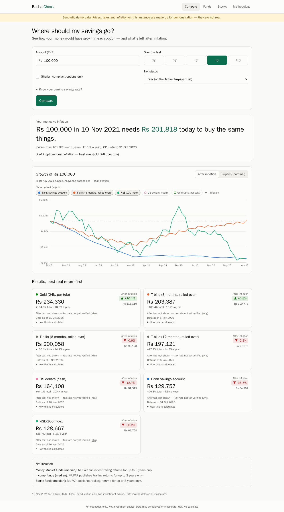
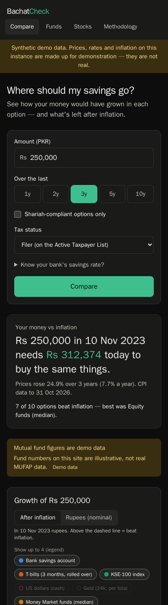
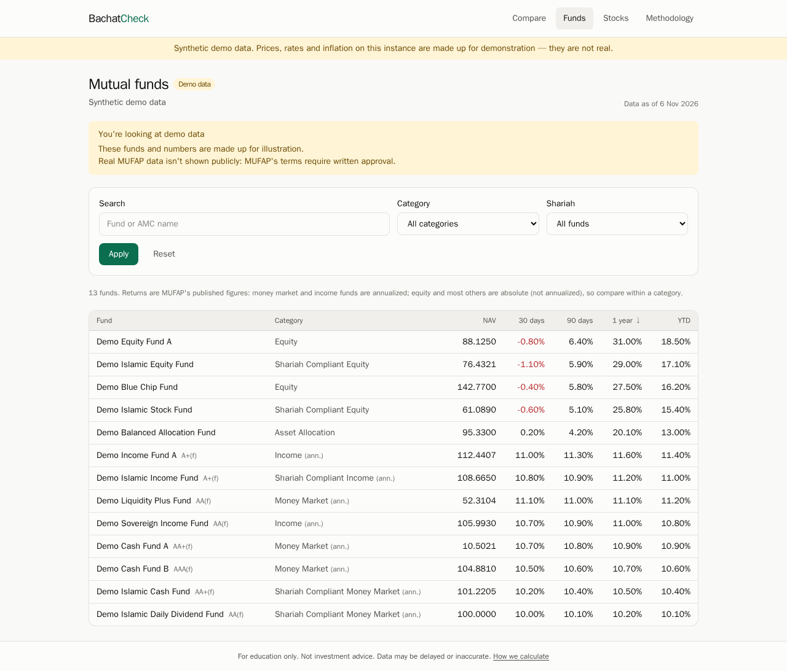
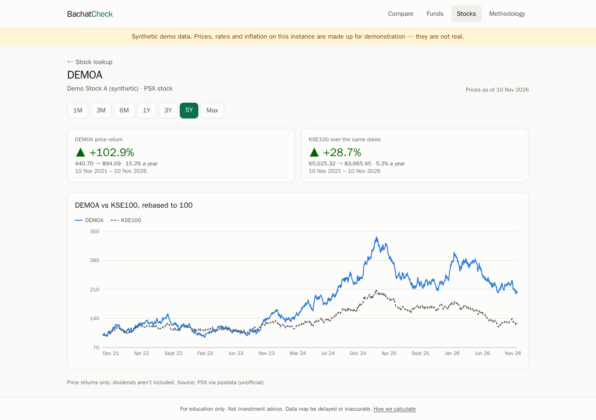
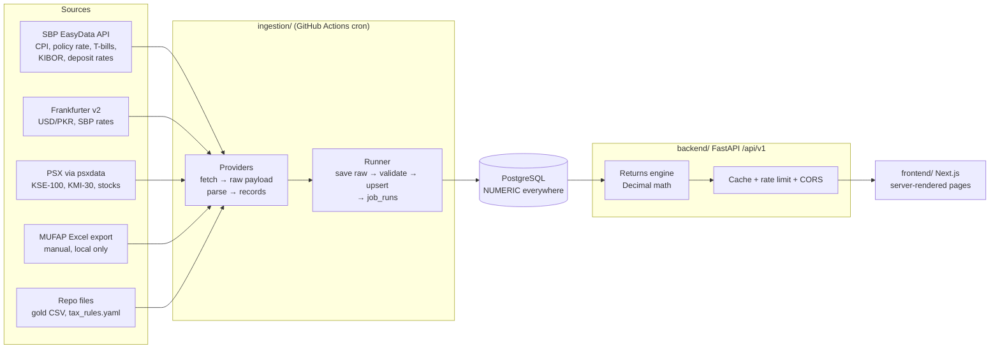

# BachatCheck: where should my savings go?

[](https://github.com/Abdullah-Akmal/BachatCheck/actions/workflows/ci.yml)
[](https://github.com/Abdullah-Akmal/BachatCheck/actions/workflows/ingest.yml)

A web app for Pakistani savers. Enter an amount and a time horizon, and BachatCheck shows how that
money would have grown in a bank savings account, T-bills, mutual funds, the KSE-100, US dollars
and gold. It also shows what's left **after inflation and tax**.

> For education only. Not investment advice. Data may be delayed or inaccurate.

<p align="center">
  
  &nbsp;
  
</p>
<p align="center"><sub>Screenshots use the synthetic demo dataset (<code>ingestion seed</code>), not real market data.</sub></p>

## The problem

Pakistani savers have had double-digit inflation, policy rates that swung from 7% to 22%, and a
rupee that lost more than half its value against the dollar, all within a few years. "My
savings account pays 10%" means little when prices rise 12% a year. The figures needed to
compare options are public but scattered across SBP, MUFAP and PSX, and none of them shows the
one number a saver needs: **did this beat inflation, after tax?**

BachatCheck puts these sources side by side and answers that with exact arithmetic and stated
assumptions. When it can't answer something honestly, it says so.

## What it does

- **Compare** (home): amount, horizon (1–10 years), Shariah-compliant filter, filer status, and
  an optional "my bank's rate". You get:
  - a headline, e.g. *"Rs 100,000 in Nov 2021 needs Rs 201,818 today to buy the same things"*;
  - a real-vs-nominal growth chart with an inflation line;
  - a card per option with total, per-year, after-inflation and after-tax returns;
  - for any option left out, the reason (e.g. no data for that period).
- **Mutual funds explorer:** filter by category or Shariah status, search, sort by any return
  window, and open a fund for its trailing returns and NAV history.
- **Stock lookup:** a PSX ticker's price history and return against the KSE-100, both rebased
  to 100. The page warns when price history is shorter than the chosen period.
- **Methodology:** the formulas, the tax assumptions (with verification status), the freshness
  of each data source, and known limitations.

Mobile-first, light and dark themes. Every page shows a "data as of" date.

<p align="center">
  
  
</p>

## Quick start: a fresh clone, no API keys

```bash
cp .env.example .env
docker compose up -d
docker compose run --rm ingestion seed
```

Open <http://localhost:3000> (API docs: <http://localhost:8000/docs>).

`seed` loads a **synthetic** dataset covering 2016 to today: deterministic and plausible-looking,
but made up. The site shows a banner while it's loaded. To use real data instead, clear the seed
and run the real sources:

```bash
docker compose run --rm ingestion seed --clear
docker compose run --rm ingestion backfill sbp --from 2015-01-01     # needs SBP_EASYDATA_API_KEY in .env
docker compose run --rm ingestion backfill frankfurter --from 2016-07-01
docker compose run --rm ingestion backfill psx --from 2016-07-01
```

## Architecture



### How data flows

1. **Fetch.** Each source has a `Provider` whose `fetch()` returns raw payloads (JSON, CSV,
   XLSX), politely: a project User-Agent, timeouts, retries with exponential backoff.
2. **Store raw first.** The runner writes the exact bytes to `raw_snapshots` (API keys stripped
   from URLs) **before** parsing, so a parser bug never loses data and history can be re-parsed.
3. **Parse and validate.** `parse()` turns a payload into typed records. Each record validates
   itself (no future dates, NAV > 0, OHLC consistency, sane percentages). Bad rows are logged
   and skipped, not fatal.
4. **Upsert.** Records are written with `INSERT … ON CONFLICT DO UPDATE` on
   `(source, identifier, date)` unique keys, so re-running a job never duplicates anything.
5. **Record the run.** Each job writes a `job_runs` row (status, rows upserted and skipped,
   redacted error). The API's `/freshness` endpoint and the Methodology page read it.
6. **Serve.** The API computes returns on request from stored data. If a source failed last
   night, the site still serves the last good data with its real "as of" date.

## Engineering decisions

| Decision | Why |
|---|---|
| **`Decimal` in Python, `NUMERIC` in Postgres, strings in JSON** | Money never touches binary floats. Source floats (psxdata, Excel) are converted through `repr()` at the boundary, so `10.83` stays `10.83`. The API sends `"125085.66"`, and the frontend converts to a number only for display. |
| **All return math in one module** ([`backend/bachatcheck/returns/`](backend/bachatcheck/returns)) | Pure functions, unit-tested against hand-worked values (shown in test comments). The real return uses the exact Fisher equation, not "nominal minus inflation". |
| **Inflation from a chained CPI index** | SBP publishes month-on-month CPI. Chaining it into an index makes inflation over any window exact, instead of approximated from year-on-year figures. |
| **Provider pattern + raw-first storage** | Adding a source means one class with `fetch()` and `parse()`. Parsers are tested against saved fixtures, never live sites. |
| **Idempotent ingestion** | Unique constraints plus upserts make jobs safe to re-run or backfill. Large batches are chunked under Postgres's bind-parameter limit. Runs left stuck by a killed process are closed out automatically. |
| **Tax rates are data, not code** ([`data/tax_rules.yaml`](data/tax_rules.yaml)) | Versioned rules (asset class, tax type, filer status, rate, effective date, source URL). After-tax figures appear **only** for rules marked verified; until then the UI says "not yet verified" rather than guessing. |
| **Missing data is reported, never faked** | No gold prices? Horizon longer than MUFAP publishes? Stock history shorter than the chosen period? The API returns `available: false` with a reason, or a `partial` flag, and the UI shows it. |
| **Licensing-aware data modes** | MUFAP's terms allow personal use only, so `FUNDS_DATA_MODE=demo` serves clearly labelled synthetic funds on the public site. `STOCKS_DATA_MODE=demo` turns PSX data off. |
| **Small, explicit middleware** | In-process TTL cache (`X-Cache`) and per-IP rate limiting as ~150 lines of tested ASGI code: right-sized for one free-tier instance. CORS allows only the frontend's origin. |
| **URL-driven, server-rendered UI** | Compare inputs live in the query string, so results are shareable. Pages render on the server. Charts follow a validated colour palette: fixed colour per asset, at most four lines, a legend, hover tooltips, and a card view of the same data. |

## How returns are calculated

All math lives in `backend/bachatcheck/returns/` and uses `Decimal` (34 significant digits).

- **Absolute return** `end / start − 1`. **CAGR** `(1 + total)^(365 / days) − 1`.
- **Real return** (exact Fisher): `(1 + nominal) / (1 + inflation) − 1`.
- **Inflation:** a price index chained from SBP's month-on-month national CPI, from the CPI month
  at/before the start date to the one at/before the end date.
- **Bank savings:** profit credited monthly at the rate in force, then reinvested. The rate is
  SBP's average deposit rate, or the user's own.
- **T-bills (3/6/12 months):** bought at the latest auction cut-off yield and rolled over at each
  maturity, actual/365. The last partial period accrues pro rata.
- **KSE-100 / KMI-30, USD, gold:** buy at the start price or rate, value at the end. Index
  levels exclude dividends.
- **Mutual funds:** the category median of MUFAP's trailing 1/2/3-year return, so horizons are
  1–3 years only. Annualized categories compound `(1 + r)^years`; absolute ones are used as is.
- **Tax:** applied only from **verified** rules. Accrual assets have tax withheld on each profit
  credit; price assets pay tax on the gain at the end, and losses aren't refunded.
- **Shariah-compliant mode** excludes interest-bearing savings and T-bills, swaps the KSE-100
  for the KMI-30, and uses Shariah-compliant fund categories.

## Data sources and licensing notes

| Data | Source | Notes |
|---|---|---|
| CPI, policy rate, T-bill yields, KIBOR, deposit rates | [SBP EasyData API](https://easydata.sbp.org.pk/) | Free API key (`SBP_EASYDATA_API_KEY`) that **expires every 90 days**. Limits: 2,000 requests/day, 250/hour. National CPI starts Jul 2016 (2015-16 base). |
| USD/PKR | [Frankfurter v2](https://api.frankfurter.dev/v2/providers), SBP provider | Free, no key. SBP publishes monthly, so rates lag by up to a few weeks. |
| KSE-100, PSX stocks | [`psxdata`](https://github.com/mtauha/psxdata) (MIT) | ⚠️ See below. |
| Mutual funds (NAV + trailing returns) | MUFAP "Performance Summary" Excel export | Manual download, local only. See below. |
| Gold (PKR per tola, 24k) | [`data/gold/`](data/gold) CSV | No free, reliable source found, so it's maintained by hand and labelled "manually updated". |
| Tax rates | [`data/tax_rules.yaml`](data/tax_rules.yaml) | **Placeholders** until verified against current FBR rules. |

**MUFAP:** its Terms of Use allow personal, non-commercial use only, and the site blocks
automated requests. BachatCheck ingests a **manually downloaded** export (kept out of git), and
the public deployment shows **demo fund data** unless MUFAP gives written permission.

**PSX:** PSX's [Terms of Use](https://psx.com.pk/psx/terms-of-use) prohibit automated retrieval
("systematic retrieval to create collections, compilations, databases") and public display
without prior written permission. `psxdata` scrapes the PSX website. The project owner has
chosen to use it for this portfolio project; usage is kept polite (one run a day after market
close, a short watchlist), and `STOCKS_DATA_MODE=demo` switches it off. Licensing contact:
marketdatarequest@psx.com.pk.

## API

Versioned under `/api/v1`, OpenAPI docs at `/docs`. Decimals are **strings**: money to 2 dp,
returns as fractions to 6 dp (`"0.126825"` = 12.68%).

| Endpoint | What |
|---|---|
| `GET /compare?amount=&years=&shariah=&filer_status=&savings_rate=` | Nominal, real and post-tax growth per asset, plus the CPI line |
| `GET /funds`, `/funds/categories`, `/funds/{symbol}` | Funds explorer (sort/filter), NAV history |
| `GET /stocks/search?q=`, `/stocks/{symbol}?period=` | Price history and return vs KSE-100 |
| `GET /macro`, `/macro/{code}` | CPI, policy rate, T-bills, KIBOR, deposit rates |
| `GET /freshness` | Last successful run per source and latest data date per dataset |
| `GET /tax-rules`, `/config` | Tax assumptions, data modes, synthetic-data flag |

Heavy GETs are cached in-process for `CACHE_TTL_SECONDS` (default 300); each client IP gets
`RATE_LIMIT_PER_MINUTE` requests (default 60; `/health` exempt).

## Ingestion commands

```bash
docker compose run --rm ingestion list
docker compose run --rm ingestion run sbp                 # also: frankfurter, psx, mufap, gold, tax_rules
docker compose run --rm ingestion run sbp --series CPI_YOY,TBILL_3M
docker compose run --rm ingestion run psx --symbols KSE100,OGDC
docker compose run --rm ingestion backfill sbp --from 2016-07-01
docker compose run --rm ingestion seed [--clear] [--force]
```

Exit codes: `0` success, `1` failed, `2` usage error, `3` partial. In production the same jobs
run on a schedule in [GitHub Actions](.github/workflows/ingest.yml).

## Tests and CI

| Suite | What it covers |
|---|---|
| **Backend** (pytest, 53) | Return formulas against hand-calculated values; T-bill rolls, monthly savings accrual and tax withholding; compare engine scenarios; every API endpoint against a seeded Postgres inside a rolled-back transaction; cache and rate limit with a fake clock |
| **Ingestion** (pytest, 53) | Parsers against trimmed real SBP/Frankfurter/PSX fixtures and a synthetic MUFAP workbook; record validation; runner tests on Postgres (idempotent re-runs, raw payload kept when parsing fails, partial runs, large-batch chunking, abandoned runs) |
| **Frontend** (Vitest + Testing Library, 27) | PKR/percent formatting, URL parsing, the compare headline, cards, chart controls and form, API error handling (including cold starts) |

[CI](.github/workflows/ci.yml) runs on every push and PR: ruff, mypy (strict), Alembic migrations
against a real Postgres, and pytest for Python; ESLint, `tsc`, Vitest and `next build` for the
frontend.

## Project structure

| Path | What |
|---|---|
| `backend/` | FastAPI app (`bachatcheck/`): models, Alembic migrations, `returns/` engine, `api/v1/` |
| `ingestion/` | `python -m ingestion`: providers, runner, writers, CLI; fixture-based tests |
| `frontend/` | Next.js App Router + TypeScript + Tailwind + Recharts |
| `data/` | Tax rules, gold CSV, demo funds, MUFAP inbox (git-ignored). See [`data/README.md`](data/README.md) |
| `infra/` | Self-contained Docker image for the API (alternative to Vercel) |
| `docker-compose.yml` | Local Postgres + API + web (+ `ingestion` tool service) |
| `backend/index.py`, `*/vercel.json`, `DEPLOY.md` | Deployment (Neon + Vercel + GitHub Actions) |

## Known limitations

- Past returns don't predict future returns. The tool looks backward only.
- **Tax rates are unverified placeholders** until filled in from current FBR rules, so after-tax
  figures don't appear yet.
- SBP's average deposit rate includes zero-profit current accounts, so the default savings
  figure understates a typical savings account. Users can enter their own rate.
- Mutual fund comparisons rely on MUFAP's trailing returns (1–3 years). NAV history builds up
  from daily snapshots over time. The public site uses demo fund data for licensing reasons.
- Index levels exclude dividends. Fees, sales loads, Zakat and exchange spreads aren't modelled.
- USD/PKR (SBP via Frankfurter) is published monthly, so the latest weeks can lag.
- Gold prices are entered by hand.
- PSX data comes from an unofficial scraper whose use PSX's terms restrict (see above).
- On the free tiers the database scales to zero and functions start cold, so the first visit
  after a quiet spell can be slow (the UI explains it if it takes too long).

## Deployment

Neon (Postgres) + Vercel (two projects: the FastAPI API and the Next.js frontend) + GitHub
Actions (migrations and daily ingestion), all on free tiers with no card. Step by step: [DEPLOY.md](DEPLOY.md).

## Running without Docker

Python 3.11+ and Node 20+, on macOS, Linux or WSL:

```bash
python -m venv .venv && source .venv/bin/activate
pip install -e "backend[dev]" -e "ingestion[dev]"
cd backend && uvicorn bachatcheck.main:app --reload
```

```bash
cd frontend && npm install && npm run dev
```

> **Windows:** Windows 11 *Smart App Control* blocks the unsigned compiled extensions that
> SQLAlchemy, psycopg and pydantic ship, so the Python side won't import natively. Use Docker
> or WSL. The frontend runs fine natively.
